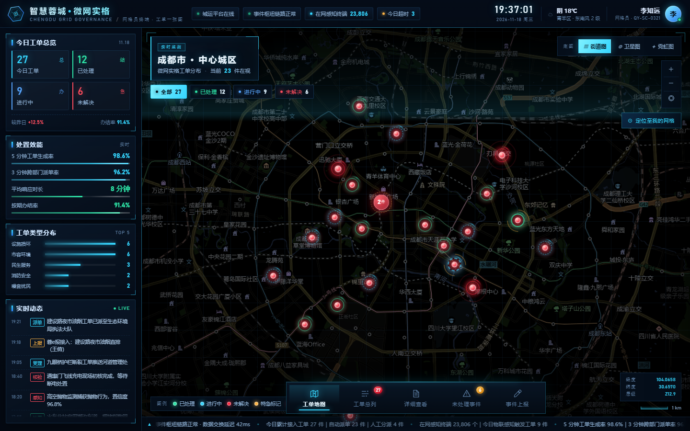
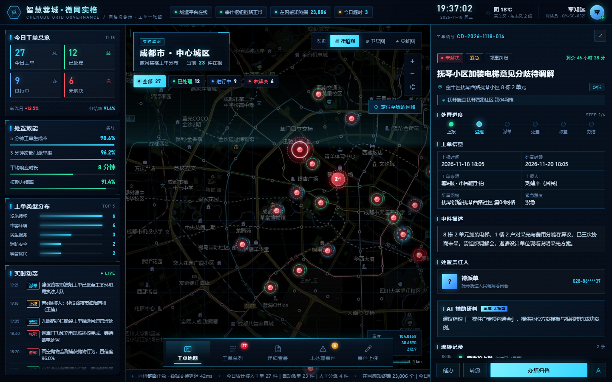

# 智慧蓉城 · 微网实格 ｜ 网格员终端 · 工单地图

仿成都「微网实格」网格员终端的**科技风工单一张图**（H5 单页，无框架、无构建、零依赖）。

## 在线访问

**https://xiaomadeshuwu.github.io/grid-map/**

手机、平板、异地电脑均可直接打开；也可以直接扫码：




## 功能

- 底图：高德街道图 / 卫星图（深色科技滤镜）；断网自动降级为内置离线霓虹底图
- 红点工单节点：点击查看「是什么事 · 谁在处理 · 处理状态（已处理 / 进行中 / 未解决）」
- 支持拖拽 / 滚轮 / 双指缩放、节点聚簇、飞行动画、经纬度与比例尺 HUD
- 底部五项互动栏：工单地图 / 工单总列 / 详细查看 / 未处理事件 / 事件上报
- 事件上报全流程：地图选点 → 自动匹配网格 → 生成工单 → 约 4 秒后模拟自动派单
- 桌面与手机自适应



## 本地打开

直接双击 `index.html` 即可（无需服务器），底图需联网。

## 更新方式

```powershell
git add -A
git commit -m "update"
git push        # 已配置为同时推送 main 与 gh-pages 分支
```

> GitHub Pages 构建源为 `gh-pages` 分支，推送后约 1 分钟自动更新。
> 也可在仓库 Settings → Pages 把 Source 改成 `main / (root)`。

## 说明

演示数据共 27 件工单，覆盖成都 12 个区（市）县、30 余个街道社区网格；指标口径参考成都「智慧蓉城」公开表述（5 分钟生成工单、3 分钟跨部门派单、平均响应 8 分钟等），仅作界面演示。
